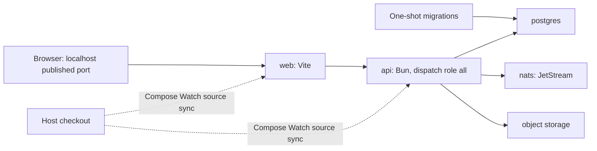

# Compose Watch development plan

Status: implemented in this working tree. Compose Watch replaces the managed
CLI runtime; isolated stacks and external/shared-infrastructure overrides are
available. Shared databases, NATS accounts, and buckets require explicit manual
provisioning, not a new orchestration CLI. This plan records the design and
acceptance requirements; it is not evidence that every runtime check passed.
See [contributor setup](../../CONTRIBUTING.md) and the
[Compose guide](../../deploy/docker-compose/README.md) for current commands.

## Decision

Make Docker Compose with Watch the default local API + web development workflow.
Run Bun/Vite in development containers, synchronize source edits, and keep Linux
dependencies and generated outputs inside the container environment. Compose
owns dependency startup, readiness, networking, persistence, and shutdown.

Retire Studio's managed-infrastructure CLI path after the replacement passes
the acceptance checks. Supported packaged runtime paths are Compose and
Kubernetes. Keep direct source commands available for development, particularly
frontend-only work against an existing API.

This change applies to the current TypeScript application. It does not depend
on the Rust rewrite, removal of Tauri, or the broader architecture redesign.

## Why change a working setup?

The current setup makes development possible, but Studio maintains an additional
infrastructure manager to do so. Its responsibilities include binary downloads,
embedded PostgreSQL, process discovery, PID/state files, port allocation, service
ownership, child-process shutdown, configuration propagation, and migrations.
Those responsibilities create maintenance work beyond the product itself.

Compose lets contributors and coding agents inspect the actual service graph,
logs, health, and persisted volumes using standard tools. Service-name DNS
removes most host-side endpoint wiring. Container-owned dependencies reduce
host/Linux native binary mismatches. Explicit migrations clarify when schema
changes run and which process owns them.

The benefit is a more repeatable environment and less custom lifecycle code to
maintain. Faster startup, lower memory, lower disk use, and a particular LOC
reduction are hypotheses to measure, not promises. Docker installation, image
downloads, synchronization, and cache management remain real costs.

## Baseline source review

This table records the pre-migration state this plan was written against.
`ensure-services.ts`, `pipeline.ts`, `cli/commands/dev.ts`, and
`scripts/dev-worktree*.ts` no longer exist; see Removal scope.

| Source | Responsibility or limitation at the time of this review |
| --- | --- |
| `deploy/docker-compose/docker-compose.postgres.yml` | Complete image-based Studio/PostgreSQL/NATS/MinIO stack; fixed container names; no explicit NATS data volume/store directory |
| `deploy/docker-compose/docker-compose.dev.yml` | Host-source development dependencies: PostgreSQL and three-node NATS; fixed names and ports |
| `selfhost/examples/docker-compose/compose.yaml` | Includes the complete stack; preserve this contributor/self-host entry point |
| `tests/multi-pod/docker-compose.yml` | Existing precedent for one-shot migrations before application processes |
| `apps/api/src/services/ensure-services.ts` (removed) | Managed local dependency lifecycle, shared by repository development and the distributed CLI |
| `apps/api/src/settings/pipeline.ts` (removed) | Resolves configuration, starts services, migrates, and assembles settings |
| `apps/api/src/cli/commands/dev.ts` (removed) | Custom development launcher and lifecycle coordination |
| `scripts/dev-worktree*.ts` (removed) | Worktree routing/ports and per-worktree managed homes |
| `apps/api/package.json` | API development currently builds sandbox packages before server startup |

This is a source review, not a successful Compose runtime verification. The
existing MinIO initializer also ends with success regardless of a preceding
bucket command's exit status; the replacement must propagate failures.

## Supported workflows

| Task | Proposed workflow |
| --- | --- |
| API + web development | Compose Watch with containerized application processes |
| Frontend against an existing API | Host Vite only, using the existing remote API proxy configuration |
| Application/runtime reproduction | Complete Compose stack using release-style application images |
| Sandbox/operator/preview routing development | Local Kubernetes, optionally with source development processes |
| Parallel backend branches | Separate application processes and state, optionally sharing local dependency servers |

There is no shared remote development cluster in this proposal. A frontend
connected to production performs real operations under its authenticated user;
this is not a substitute for isolated backend development.

## Service and configuration model



The initial lightweight application topology uses one API process with the
existing `all` dispatch role. A selectable split API/worker topology exercises
the existing roles without forcing extra application processes into every
development session. Compose does not make Kubernetes agent sandboxes available;
those require an explicitly configured existing provider or local Kubernetes.

- Use internal service endpoints such as `postgres:5432`, `nats:4222`, and
  `api:3000`. The browser uses a published localhost URL, never Docker DNS.
- Preserve the browser's public origin through the local Vite API proxy. Do not
  use the production-target proxy's origin rewriting for the internal API hop.
- Publish only necessary ports, on loopback by default. Keep service ports
  internal unless a contributor opts into host database/debug access.
- Configure the public URL, auth origin, published web port, and HMR endpoint
  together. Separate application configuration from Compose interpolation.
- Use checked-in non-secret development defaults and documented overrides.
  Keep personal credentials out of images, source sync, and committed files.
- Keep auth/encryption keys stable across restarts for the lifetime of the
  associated data. Do not silently rotate keys on container recreation.
- Use portable images on supported developer architectures and pin versions.
  Choose and document dependency versions against the production baseline.

## Compose organization

The following was the proposed decomposition. The implementation instead keeps
the existing complete-stack definitions reusable via `extends`, with a root
`compose.yaml` development entry point and optional shared-infrastructure
overrides; see the Compose guide for the actual files.

```text
deploy/docker-compose/
  compose.infra.yaml     # reusable dependency services
  compose.app.yaml       # application and migration services
  compose.dev.yaml       # source-built dev images and Watch rules
  compose.cluster.yaml   # optional multi-node NATS topology
```

Provide a root entry point for the common development workflow so contributors
can run `docker compose up --build --watch` without memorizing file combinations. Reuse
the dependency definitions across development and the existing self-host example.
Use profiles for optional services and overrides for alternative configurations.
Do not create a profile for every combination of local/external endpoints.

The default has one NATS server with JetStream, persistent storage, and suitable
single-node stream settings. Keep the clustered configuration for replication
and failure testing. Retain current NATS functionality during this migration.

## Source synchronization and builds

- Use dedicated development image stages; retain production packaging behavior.
- Install workspace dependencies from the checked-in lockfile inside Linux.
- Sync application source, shared packages, and required assets. Each service
  watches its actual inputs, including shared contract and UI changes.
- Exclude host `node_modules`, `dist`, Rust `target`, `.git`, credentials,
  environment files, logs, and local runtime state from build contexts and sync.
- Sync source changes and let Bun/Vite handle reload. Do not rebuild an image
  for every source edit.
- Rebuild when dependency manifests, the lockfile, or the development image
  definition change. Validate workspace dependency changes as well as root ones.
- Define initial synchronization so restarting Watch cannot serve stale source.
- Keep generated sandbox packages inside Linux. Specify their input changes and
  rebuild behavior explicitly; source synchronization alone does not generate them.
- Keep application data in named volumes outside synchronized source directories.
- Do not rely on generated files being synchronized back to the host. Use an
  explicit export command for generated artifacts intended for source control.

Document and validate the minimum Compose version needed by the chosen rules.
Build dependency installation layers for reuse, and use a bounded package cache
where useful. Dependency trees and mutable output directories remain isolated
between worktrees; share download/build caches rather than writable installations.

## Parallel worktrees and shared infrastructure

Support an isolated full stack first. Before retiring the current worktree
workflow, also support one local dependency stack reused by multiple branches.

| Resource | Shared across worktrees | Worktree-specific |
| --- | --- | --- |
| PostgreSQL | Server and storage volume | Database and restricted role; DBOS schema/queues stay in that database |
| NATS | Server/cluster | Account, credentials, JetStream resources, and account limits |
| Object storage | Server | Bucket and scoped credentials |
| Application | Image layers and suitable caches | Processes, published ports, mutable files, generated outputs |
| Source | Repository history | Checkout and Compose project identity |

An explicit shared Docker network gives application projects dependency-service
DNS names. Compose project names alone do not isolate subjects, rows, credentials,
or object keys in a shared dependency server. Existing fixed NATS subjects make
unisolated server/account sharing unsafe.

Provision scoped resources explicitly with PostgreSQL, NATS, and object-storage
tools as documented in the Compose guide. The implementation adds no resource
provisioning CLI. Account additions/reloads and branch cleanup remain deliberate
operator actions; Compose does not create tenant isolation inside shared servers.

Use explicit worktree port assignments or a separately documented routing helper.
Stopping one worktree must leave shared infrastructure and other worktrees alive.
Worktree deletion removes only its scoped resources, with explicit confirmation
for deleting persisted data. Never use blanket volume deletion as branch cleanup.

## Migrations and lifecycle

- Dependency services expose meaningful readiness checks.
- Bucket initialization fails if provisioning fails.
- A one-shot migration service runs Better Auth and application migrations in
  their existing order, then the standalone DBOS migration entry point.
- Application startup waits for successful preparation and does not invoke the
  managed-infrastructure CLI. DBOS launch still follows its existing schema lock.
- Failed migrations block startup; never suppress schema-version errors.
- After adding migrations during development, run the migration command and
  restart affected services explicitly. Hot reload is not a migration scheduler.
- Retain backward-compatible migration rules and existing production mechanisms.
- Seed isolated development databases with synthetic data. Do not import live
  workflow queues, provider secrets, or webhook delivery state.
- Normal shutdown retains data; reset and destructive deletion are explicit.

## Removal scope

Done. The repository and distributed CLI paths that managed embedded
PostgreSQL, downloaded NATS/MinIO, tracked service PIDs/state/ownership, or
started/stopped infrastructure with the application were removed, along with
obsolete service commands, TUI lifecycle code, managed worktree homes, tests,
dependencies such as `embedded-postgres`, and documentation for those paths.

Audit all callers, including `serve` and packaging, before deleting shared code.
Retain application configuration validation, health checks, migrations, graceful
application shutdown, and useful non-runtime CLI operations. A hostname-routing
helper may remain if it is useful independently of service management.

## Future Rust builds

Compose remains responsible for service topology and connectivity. Rust source
sync triggers a development compiler/watcher inside the Linux environment;
Compose sync alone does not run Cargo. Prefer one Cargo workspace, a pinned
toolchain, separate per-worktree outputs, and a shared bounded `sccache`.

Benchmark reduced debug information and disabled incremental compilation before
standardizing them. `sccache` Rust support requires incremental compilation to be
disabled; its cache-size cap does not cap Cargo output directories. Define target
cleanup for retired worktrees and avoid maintaining host and Linux builds by
default. No Cargo configuration is introduced in the TypeScript migration.

## Delivery and acceptance

| Phase | Deliverable | Evidence required |
| --- | --- | --- |
| 1 | Reusable infrastructure, development images, Watch entry point | Fresh checkout starts API + web; health, auth, persistence, and migration failure behavior verified |
| 2 | Complete source/dependency change loop | Web HMR, API reload, shared package changes, sandbox package preparation, lockfile rebuild, and Watch restart verified |
| 3 | Parallel worktree support | Two divergent branches share servers without sharing jobs, events, objects, migrations, or credentials; independent teardown verified |
| 4 | Contributor documentation and default switch | Compare startup, edit latency, actual memory, and disk use for one/two worktrees; verify frontend-only and local Kubernetes workflows |
| 5 | Delete managed CLI runtime | Audit callers, remove unused dependencies/tests/docs, run repository verification and focused integration checks |

Introduce the replacement as an opt-in development path while validating it.
Keep the default switch separate from deletion so it can be reverted during
rollout. Do not carry the old infrastructure manager as a permanent fallback.

Measure actual Docker VM and process consumption, not just configured memory
limits. Check cold and warm starts, dependency rebuilds, disk growth and cleanup,
and shutdown with work in flight. Include Apple Silicon; document any additional
supported platforms that have not yet been exercised.

## Open decisions

- Exact image pins and minimum Compose version.
- Shared infrastructure network and NATS account provisioning/reload design.
- Worktree port configuration versus retaining optional hostname routing.
- Sandbox generated-artifact rebuild rules and optional API/worker topology.
- Which personal/provider configuration is needed for the default onboarding path.
- Measured acceptance budgets for startup, reload latency, memory, and disk.

## References

- [Compose Watch](https://docs.docker.com/compose/how-tos/file-watch/)
- [Compose networking](https://docs.docker.com/compose/how-tos/networking/)
- [Startup order and migration completion](https://docs.docker.com/compose/how-tos/startup-order/)
- [Compose profiles](https://docs.docker.com/compose/how-tos/profiles/)
- [Multiple Compose files](https://docs.docker.com/compose/how-tos/multiple-compose-files/)
- [NATS account isolation](https://docs.nats.io/learn/security/accounts-and-multitenancy)
- [Cargo build cache](https://doc.rust-lang.org/cargo/reference/build-cache.html)
- [sccache Rust support](https://github.com/mozilla/sccache/blob/main/docs/Rust.md)
