# Plan: do objetivo da loja ao business case

Status: proposta, revisada em 17/11/2026 depois de 41 mudanças no motor de
diagnóstico externo. Nenhum código de produto foi escrito ainda; esta doc
fecha o desenho antes da Fase 1.

Todos os números dos protótipos são sintéticos. Os prints do motor atual foram
tirados com domínio, marca, pessoas, concorrentes e imagens mascarados.

## 1. Problema

A página **Plan** existe no menu (`/$org/plan` e `/$org/projects/$agentId/plan`),
mas só mostra um "Coming soon"
(`apps/web/src/routes/workspace/plan.tsx` →
`components/coming-soon/coming-soon-page.tsx`). O item do menu tem
`soon: true` em `components/sidebar/nav-destinations.tsx`.

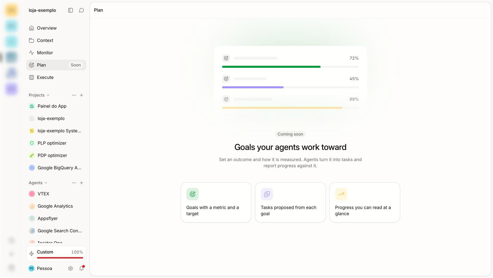

Enquanto isso, o diagnóstico estratégico de uma loja é feito à mão: entrevistas,
dados, pesquisas, benchmarks, oportunidades e soluções. No último caso em que
isso foi feito artesanalmente, levou cerca de dois meses. O Plan automatiza esse
trabalho de dois jeitos:

1. **Reativo, quando a pessoa tem uma ideia.** Ela escreve, grava um áudio ou
   anexa um arquivo ("trocar a cor do botão da PDP", "mostrar o prazo de entrega
   antes do carrinho"). O Studio monta o material que ela precisa para convencer
   o time: quem já faz, impacto estimado, esforço de desenvolvimento, tags,
   duração do teste A/B e ganho provável. É um *business case*, não uma
   resposta de chat.
2. **Proativo, quando ninguém pediu.** O Studio entende o objetivo da empresa,
   mede onde a loja perde mais para esse objetivo, investiga o porquê e entrega
   **as duas maiores perdas**, cada uma com o estado real da investigação.

## 2. Princípios

| Princípio | Na prática |
| --- | --- |
| **Goal-driven** | A análise começa pelo objetivo do negócio, não por uma página ou ferramenta. O objetivo decide quais páginas e etapas do funil entram na rodada. |
| **Perda medida, causa investigada** | A oportunidade é uma perda **medida em código** ("no celular, 10,4% de quem vê um produto põe no carrinho; no computador, 24,1%"). O modelo não inventa a oportunidade; ele propõe as causas, que são as hipóteses. |
| **Hierárquico** | Macro: *onde* a loja perde (home, categoria, busca, produto, carrinho/checkout). Micro: *por que* perde, com hipóteses em seis categorias (UX, performance, confiança, comercial, tráfego, tecnologia). |
| **Data-driven e honesto** | Todo número cita a fonte e a janela. Os dados recebem uma nota de confiança (amostra, ruído, comparação justa, se a diferença se repete). Uma hipótese só fica "pronta para testar" depois de verificada na loja no ar, no código e nos dados, e de passar por uma revisão independente. |
| **Nada some** | Hipóteses desmentidas ficam visíveis, com o motivo. Isso evita recomendar o que já foi derrubado e mostra o trabalho feito. |
| **Solution-oriented** | O resultado liga Problema → Hipótese → Solução → Impacto. Quando já existe uma solução da deco para a causa (por exemplo, compre-o-look automático, régua de vestibilidade, fundo de imagem), ela é recomendada. |
| **Restrições reais** | Áreas podem estar bloqueadas (outro time, outro decisor, um checkout recém-redesenhado). A pessoa marca uma área como "fora de escopo agora", e a rodada respeita isso. |

## 3. Experiência

### 3.1 Desenho de referência

Os dois mockups abaixo são a direção visual.

| Claro | Escuro |
| --- | --- |
| 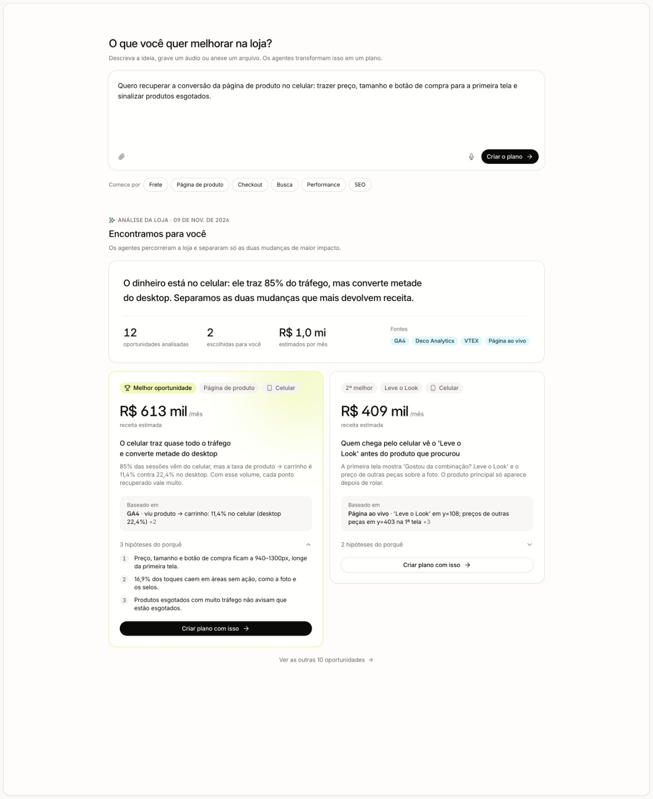 | 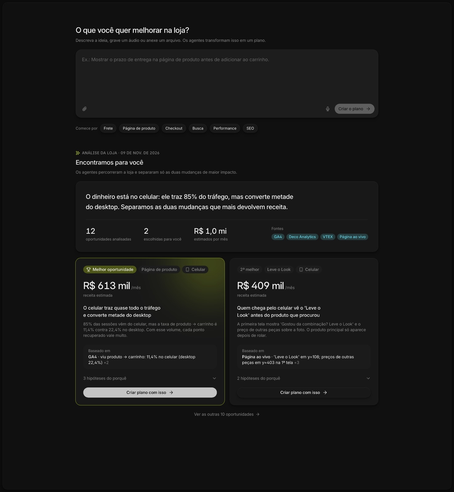 |

### 3.2 Protótipo com o tema do Studio

O protótipo usa os tokens reais do Studio (`packages/ui/src/styles/global.css`:
`surface`, `surface-inset`, `hairline`, `text-meta`, `brand`,
`brand-lime-tint`, `success`, `warning`; o modo escuro sai dos tokens). Ele
mantém o desenho dos mockups e acrescenta o que o motor novo exige: o
**estado** de cada perda e um CTA que muda com esse estado.

| Claro | Escuro |
| --- | --- |
| 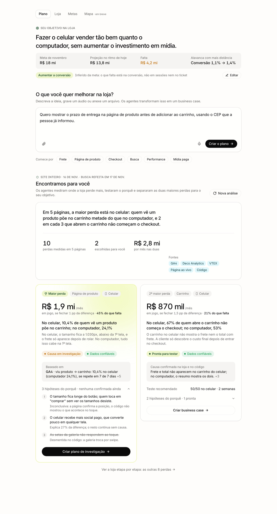 | 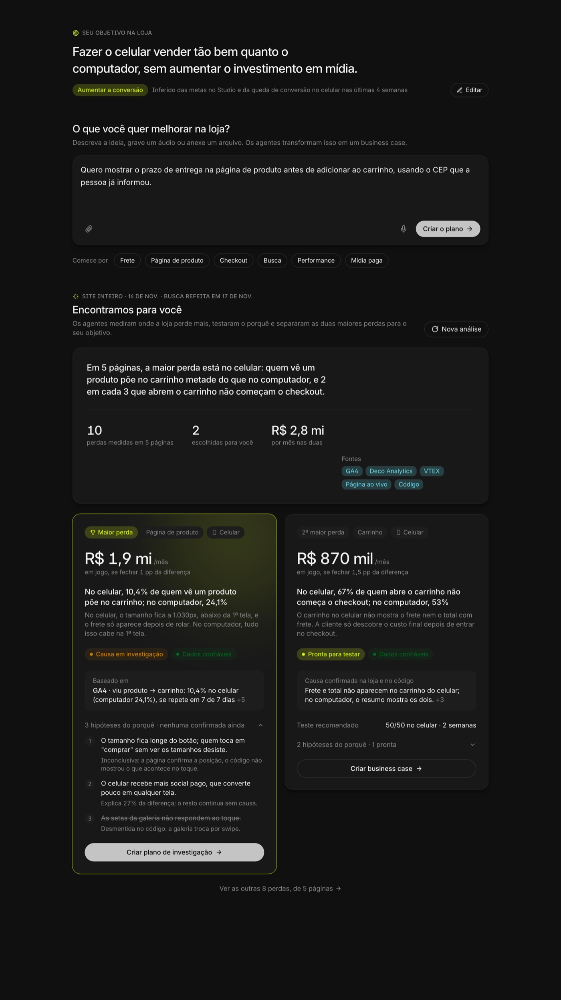 |

A página tem, de cima para baixo:

1. **Objetivo na loja**, no topo. Uma frase que resume o que a pessoa quer da
   loja agora ("Fazer o celular vender tão bem quanto o computador, sem
   aumentar o investimento em mídia"), o tipo de objetivo que ela move
   ("Aumentar a conversão"), de onde a frase veio e "Editar". Tudo abaixo é
   lido à luz dessa frase.
2. **Composer da ideia.** "O que você quer melhorar na loja?", com anexo, áudio
   e o botão "Criar o plano". Os chips "Comece por" preenchem um ponto de
   partida.
3. **Cabeçalho da análise.** Escopo e data da análise, inclusive quando uma
   página foi refeita depois ("Site inteiro · 16 de nov. · busca refeita em 17
   de nov."), e o botão **"Nova análise"**.
4. **Resumo.** Uma manchete, quantas perdas foram medidas e em quantas páginas,
   o R$/mês em jogo nas duas escolhidas e as fontes que responderam.
5. **Dois cards**, as duas maiores perdas do site inteiro que não sejam o mesmo
   problema:
   - selo ("Maior perda" / "2ª maior perda"), página e dispositivo;
   - R$/mês em jogo e a premissa da conta ("se fechar 1 pp da diferença");
   - título: a perda medida, escrita pelo código;
   - o que foi visto na página;
   - **estado**: "Causa em investigação" ou "Pronta para testar", mais a
     confiança nos dados;
   - "Baseado em" (ou "Causa confirmada na loja e no código");
   - hipóteses, cada uma com o resultado da verificação, inclusive as
     desmentidas, riscadas;
   - teste recomendado, quando há hipótese pronta;
   - CTA: **"Criar plano de investigação"** ou **"Criar business case"**.
6. **"Ver as outras N perdas"**, a lista do site inteiro.

**Por que o estado é obrigatório.** Na última rodada real do motor (5 páginas,
10 oportunidades, 25 hipóteses), só **1** hipótese chegou a "pronta para
experimento", e era a da perda de menor valor. A maior perda tinha 5 hipóteses:
2 desmentidas, 2 inconclusivas e 1 bloqueada. Se o Plan mostrasse só o que está
pronto, mostraria quase nada. Se mostrasse a maior perda como se a causa fosse
conhecida, mentiria. Por isso o Plan ordena pelas maiores perdas e diz em que
pé está cada uma.

#### Editar o objetivo

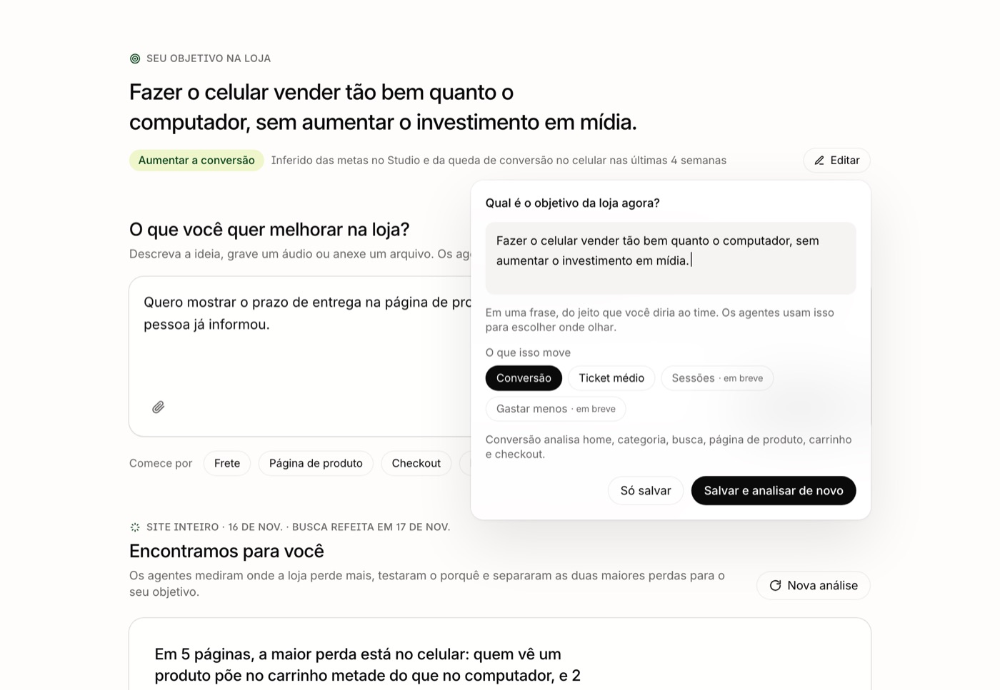

A pessoa reescreve a frase do jeito que diria ao time e confere o tipo de
objetivo que ela move. O tipo decide quais páginas e etapas entram na rodada
(ver 4.1); tipos sem cobertura aparecem como "em breve". "Salvar e analisar de
novo" dispara uma rodada do site inteiro com o objetivo novo; "Só salvar" vale
a partir da próxima rodada.

#### Nova análise, manual

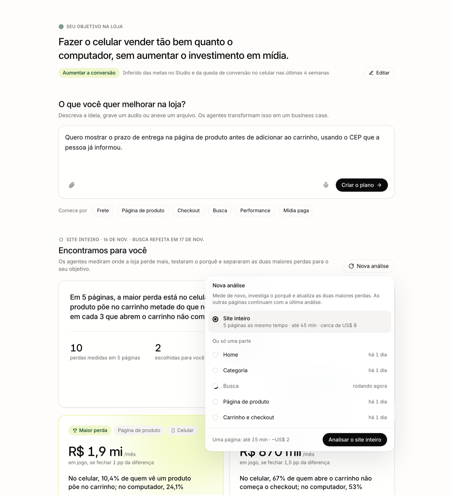

Além da rodada semanal, a pessoa pode pedir uma análise a qualquer momento:

- **Site inteiro:** todas as páginas que o objetivo cobre, ao mesmo tempo (até
  uns 45 minutos, cerca de US$ 8).
- **Só uma parte:** home, categoria, busca, página de produto ou carrinho e
  checkout (até uns 15 minutos, cerca de US$ 2). Serve para refazer uma página
  depois de uma mudança no site ou de instrumentar um evento.

Cada página mostra quando foi analisada pela última vez. Uma página que já está
rodando aparece como "rodando agora" e não pode ser pedida de novo. Quando só
uma parte é refeita, as outras páginas continuam com a última análise e o top 2
é recalculado sobre o conjunto (ver 4.6).

#### Estados

| Rodando | Sem fontes conectadas |
| --- | --- |
| 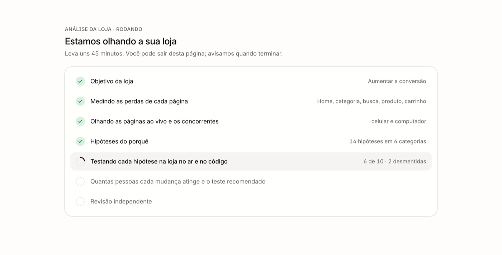 | 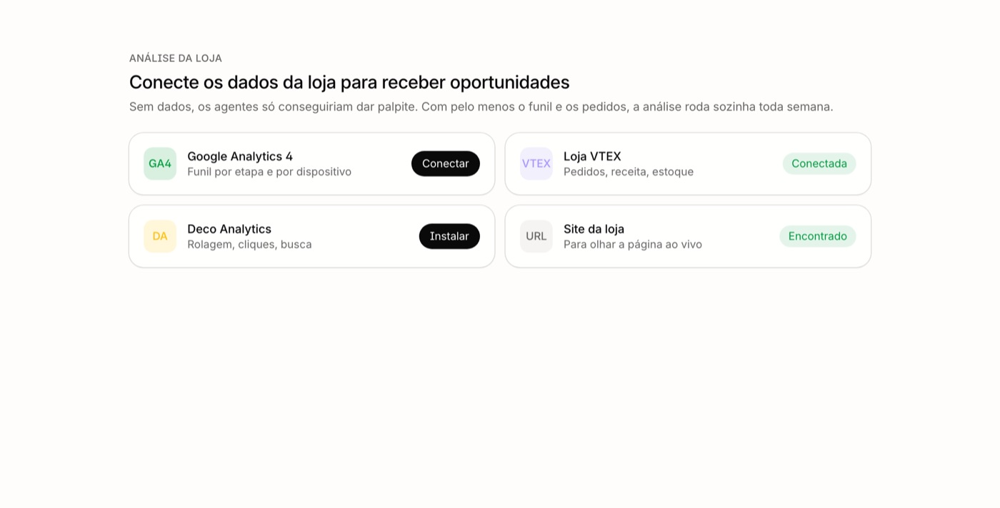 |

- **Rodando.** Mostra as etapas reais do pipeline. Uma rodada do site inteiro
  leva até uns 45 minutos. A pessoa pode sair; a conclusão chega por
  notificação.
- **Sem fontes.** Sem funil e pedidos não há perda medida, só palpite. A tela
  convida a conectar GA4, a loja e o Deco Analytics. Sem Deco Analytics não há
  relevância, e nenhuma hipótese chega a "pronta" (ver 5.2).
- **Erro.** Mostra a etapa que falhou e um botão para rodar de novo. Nenhuma
  etapa paga é repetida automaticamente.

#### Largura estreita

Com o painel de chat aberto ao lado, a página encolhe. Os cards empilham e os
chips quebram linha.

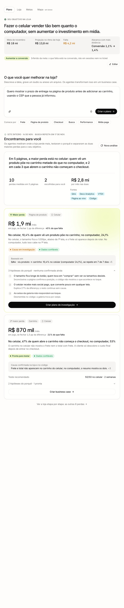

### 3.3 O que o CTA gera

Os dois CTAs abrem um chat com o agente de Plan, que grava um documento nos
arquivos da org, em `planos/AAAA-MM-DD-<slug>.md`. O chat recebe a oportunidade
inteira (perda medida, confiabilidade, hipóteses, verificação, dossiê), então
o agente não recomeça do zero. Na web isso é
`useChatTask().createTaskWithMessage(...)`
(`apps/web/src/components/chat/chat-context.tsx`).

#### Business case, quando há hipótese pronta para testar

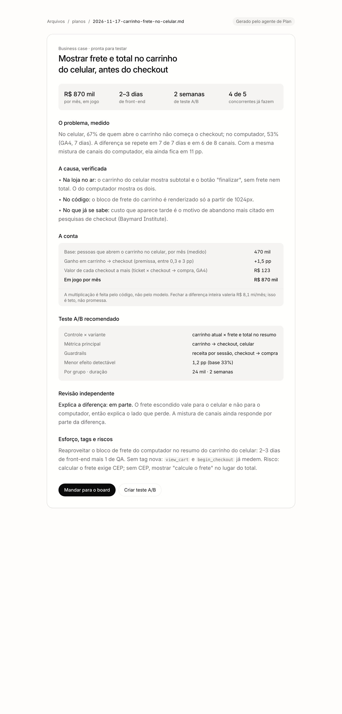

Quase tudo já vem do dossiê da hipótese; o agente acrescenta esforço, tags e
riscos.

| Seção | De onde vem |
| --- | --- |
| Resumo em números | Conta da oportunidade, esforço, duração do teste, benchmark |
| O problema, medido | Perda medida e checagens de confiabilidade |
| A causa, verificada | Verificação na loja no ar, no código e nos dados; base de conhecimento citada |
| A conta | `base × Δpp × valor por evento`, calculada pelo código (ver 6.4). O gap inteiro aparece só como teto. |
| Teste A/B recomendado | Desenho do experimento: controle e variante, métrica, guardrails, menor efeito detectável, tamanho por grupo, semanas |
| Revisão independente | "Explica a diferença: sim / em parte / não" |
| Esforço, tags e riscos | Agente, a partir do código e da intervenção |
| Próximo passo | "Mandar para o board" e "Criar teste A/B" (`EXPERIMENT_CREATE`) |

#### Plano de investigação, quando a causa ainda não foi confirmada

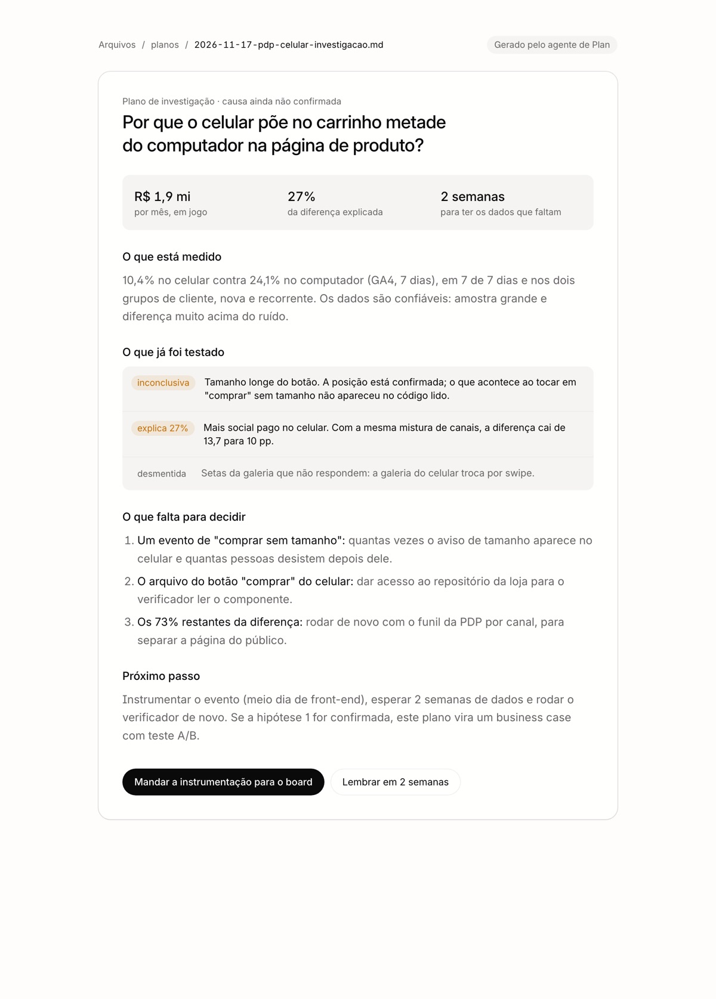

Responde a pergunta "o que falta para decidir?". Sai do mesmo material:

- o que está medido (perda e confiança);
- o que já foi testado, com o resultado de cada hipótese, inclusive quanto da
  diferença cada uma explica;
- o que falta: eventos a instrumentar, acesso ao código que o verificador não
  conseguiu ler, recortes de dado que faltaram (vem de `como_verificar`, dos
  limites da rodada e do motivo de parada);
- próximo passo e quando rodar de novo.

Quando a hipótese é confirmada numa rodada seguinte, o plano vira business
case.

## 4. Fluxo proativo

```text
objetivo → páginas e etapas → perdas medidas → top 2 distintas → hipóteses
  → verificação (loja, código, dados) → relevância → teste recomendado
  → revisão independente → estado → Plan
```

### 4.1 Objetivo

O objetivo tem duas partes:

- **a frase**, em linguagem da pessoa, que aparece no topo do Plan e entra no
  prompt de cada etapa da análise (por exemplo, "sem aumentar o investimento em
  mídia" faz o agente não recomendar mais mídia paga);
- **o tipo**, que decide quais páginas e etapas entram na rodada.

Os dois são inferidos do que a org já declarou (metas, contexto do projeto,
conversas) e dos dados (por exemplo, queda de conversão em 4 semanas). O Studio
guarda a frase, o tipo, a evidência e se foi **inferido**, **confirmado** ou
**editado** pela pessoa. Uma edição da pessoa nunca é sobrescrita pela
inferência; quando os dados mudam muito, o Plan sugere revisar a frase em vez
de trocá-la.

| Objetivo | Páginas e etapas na rodada | Cobertura do motor hoje |
| --- | --- | --- |
| Aumentar a conversão | Home, categoria, busca, produto, carrinho e checkout | Completa |
| Aumentar o ticket médio | Produto e carrinho (recomendações, frete grátis, combos) | Parcial: mede as etapas, não tem métrica de ticket |
| Trazer mais sessões | SEO, mídia paga, performance | Nenhuma |
| Gastar menos para vender o mesmo | Eficiência de mídia, frete, devoluções | Nenhuma; os recortes por canal já mostram sinais (ex.: social pago com conversão muito baixa) |

Objetivos sem cobertura aparecem como "em breve" no seletor e não disparam
rodada.

### 4.2 Perdas medidas

Para cada página, o código mede só as etapas do funil que aquela página
controla (por exemplo, produto → carrinho na PDP, e as seis etapas do checkout
no carrinho). Cada perda é de um destes tipos:

- **absoluta**: quanto do dispositivo não passa da etapa;
- **dispositivo**: celular pior que computador, fora da faixa de ruído de 95%;
- **segmento**: um canal ou grupo (nova × recorrente) converte ≤ 0,85× o resto
  (só na PDP).

O título é escrito pelo código. A conta do dinheiro também (ver 6.4). Cada
perda ganha uma nota de **confiabilidade** (alta, média, baixa) com as
checagens: amostra, ruído, fonte, tracking, comparação justa (o gap com a mesma
mistura de canais do outro dispositivo) e se a diferença se repete por canal,
por grupo e por dia.

### 4.3 Top 2

`valor × confiança`, com as perdas de confiabilidade baixa no fim, sobre o
**site inteiro**. Duas perdas que são o mesmo problema não entram juntas; a
segunda vira reserva. O objetivo já filtrou as páginas, então não entra como
peso extra.

### 4.4 Investigação

Para cada perda escolhida:

1. **Hipóteses.** Até 3 por perda, em seis categorias, no formato "Se
   [intervenção], então [métrica] [sobe], porque [mecanismo]". Cada uma traz
   evidências a favor e contra (marcadas como fato, indireto ou inferência), o
   alvo na página, como verificar e como refutar. Uma hipótese sobre uma perda
   de dispositivo precisa dizer por que acontece naquele dispositivo.
2. **Base de conhecimento.** Entra no prompt o que a loja já sabe (A/Bs dela,
   vereditos anteriores do verificador, decisões do time) e uma curadoria
   universal (estudos e boas práticas, por editora). Um A/B da própria loja que
   contradiz a hipótese derruba a hipótese.
3. **Desafio.** Uma revisão adversária derruba ou rebaixa hipóteses fracas.
4. **Verificação.** Até 4 checagens por hipótese:
   - **na loja no ar**: abrir, rolar, escolher tamanho, tocar, esperar e
     inspecionar, num navegador com rastreadores bloqueados, sem nunca tocar em
     sacola, checkout, login ou formulário;
   - **no código**: leitura do repositório da loja;
   - **nos dados**: recortes de tráfego.

   O veredito é decidido em código: confirmada, desmentida, reescrita ou
   inconclusiva. Uma prova a favor e uma contra viram conflito, não vitória.
5. **Relevância.** Quantas pessoas por semana a mudança atinge, pela curva de
   rolagem e pela posição do alvo. Sem relevância mínima, a hipótese para.
6. **Teste recomendado e prioridade.** Desenho do A/B (amostra, menor efeito
   detectável, semanas; mais de 8 semanas = não mensurável) e duas prioridades,
   de investigação e de teste, a partir de impacto, confiança, abrangência,
   esforço, risco e mensurabilidade.
7. **Revisão independente.** Lê só os dossiês das hipóteses prontas e responde
   se a hipótese explica a diferença. Só pode rebaixar.
8. **Estado.** Cada hipótese termina num ciclo de vida: gerada → em
   investigação → condição confirmada → relevância avaliada → **pronta para
   experimento**, ou refutada, inconclusiva, bloqueada, sem relevância. Cada
   perda guarda por que a investigação parou: achou causa candidata, todas
   descartadas, evidências esgotadas, orçamento ou dados insuficientes. Uma
   perda sem nenhuma hipótese de pé é aposentada e a reserva entra no lugar.

### 4.5 Soluções

Cada hipótese pronta é comparada com um catálogo de soluções existentes (apps e
agentes da deco). Quando bate, o card mostra a solução, e o business case passa
a incluir "usar a solução X" com esforço menor. O catálogo não existe ainda
(F5).

### 4.6 Quando roda

- Uma vez por semana, para cada org com o recurso ligado e com fontes
  conectadas: site inteiro.
- Quando a pessoa salva um objetivo novo e pede para analisar de novo: site
  inteiro.
- Quando a pessoa pede uma **nova análise**: site inteiro ou uma página.
- Quando a pessoa pede só a verificação de uma hipótese de novo, depois de
  instrumentar um evento ou dar acesso ao código.

O Plan mostra a **visão da loja**: para cada página, a última análise
concluída. O top 2 é calculado sobre essa visão. Assim, refazer só a busca
atualiza as perdas da busca e pode mudar o top 2, sem perder o resto.

Uma rodada por org e página de cada vez. Um novo pedido para uma página que já
está rodando devolve a rodada em andamento. Até a nova terminar, o Plan
continua mostrando a última concluída daquela página.

## 5. O motor de hoje, que será portado

O diagnóstico existe hoje como app externo (Cloudflare Worker + MCP App). Ele
deixou de ser só de PDP: analisa o site inteiro. As telas abaixo foram
capturadas com dados mascarados.

| Analisar o site e fontes | Onde o site perde mais |
| --- | --- |
| 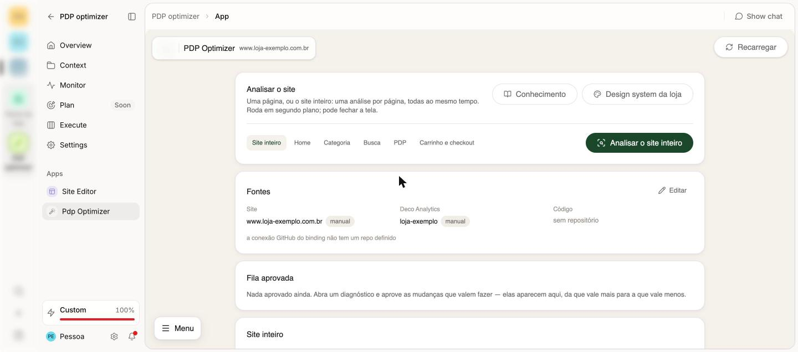 | 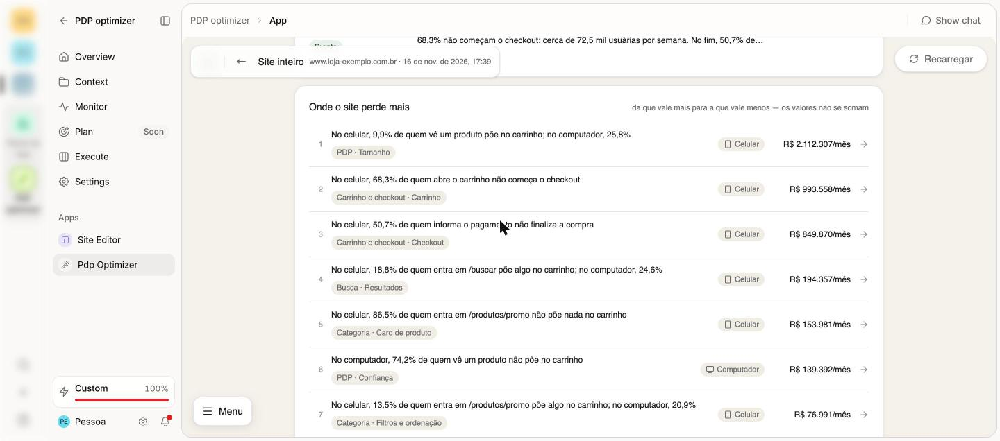 |

| Perda medida e confiança nos dados | Hipótese e o que a verificação viu |
| --- | --- |
| 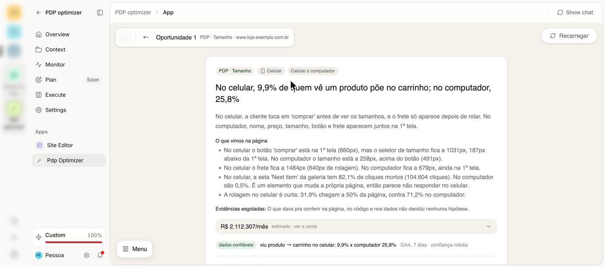 | 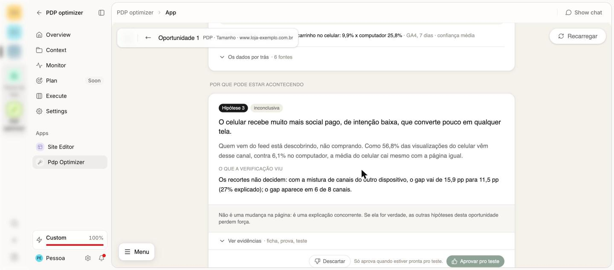 |

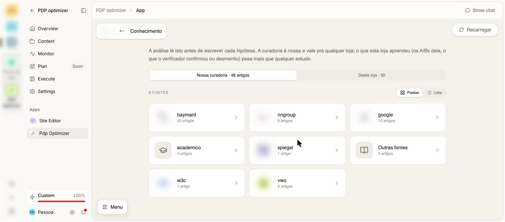

### 5.1 Pipeline atual

Uma rodada do site inteiro dispara um diagnóstico por página (home, categoria,
busca, PDP, carrinho/checkout), todos ao mesmo tempo e ligados por um
`site_run_id`. Cada diagnóstico roda como **quatro instâncias encadeadas** de
um Cloudflare Workflow, porque cada instância tem um teto de cerca de 1.000
subrequests.

| Instância | Etapas |
| --- | --- |
| 1. Coleta | `collect` (funil GA4 com recortes por canal, nova × recorrente e dia; heatmap, elementos, funil e rolagem do Deco Analytics; receita no lake; estoque VTEX na PDP; termos mais buscados na busca) → `capture` (página ao vivo, posições dos elementos) → `benchmark` (concorrentes) |
| 2. Análise | `opportunities` (perdas medidas em código; o modelo escolhe e escreve as observações) → `hypotheses:<n>` (árvore e desafio, por lote) |
| 3. Verificação | `repo-snapshot` → `verify:<id>` (loja no ar e código) → `data-checks` → aposentar perda sem hipótese de pé e trocar pela reserva |
| 4. Dossiê | `relevance` → `experiment-priority` → `review` → mockups Antes/Depois só para hipóteses prontas → `finish` |

O carrinho/checkout só usa o funil do GA4: não tem captura, heatmap nem
benchmark.

Custo e tempo observados: cerca de US$ 0,60–2,50 por página e US$ 6–9 por
rodada do site inteiro, de 5 a 45 minutos por página. Os modelos são Claude
Opus (oportunidades, hipóteses, revisão) e Claude Sonnet (desafio,
verificador, benchmark), via OpenRouter.

### 5.2 Regras que vêm junto

- Toda fonte que falha vira uma **lacuna nomeada** e a rodada continua.
- **O modelo não calcula nem escolhe números.** Perdas, conta, confiabilidade,
  relevância, desenho do teste, prioridade e veredito final do verificador são
  código. O modelo escolhe entre perdas medidas, escreve observações e propõe
  hipóteses e checagens.
- Δpp entre 0,3 e o menor de 3 pp e o gap. A conta não usa mais fração de
  canal.
- Steps pagos **não têm retry automático**. O verificador tem 10 minutos por
  hipótese, uma reescrita no máximo.
- Nada é apagado: hipóteses refutadas e perdas aposentadas ficam com o motivo.
- Sem Deco Analytics não há relevância, e nada chega a "pronta".

### 5.3 O que o próprio motor diz que ainda não foi feito

- Boa parte das mudanças recentes foi verificada com testes de unidade e
  previews de mentira. O formato novo de perdas e o verificador ainda não
  rodaram de ponta a ponta em navegador e repositório reais.
- Cinco páginas em paralelo podem estourar o limite de sessões de navegador.
- Sem recorte por categoria de produto e sem comparação entre rotas do mesmo
  template.
- Home, categoria e busca não têm perdas de segmento.
- O nível causal é sempre "não testado": quem prova a causa é o A/B.
- Servir uma segunda loja exigiu um ambiente de Worker separado, com deploy e
  migrations manuais. **No Studio isso deixa de existir**: tudo é por org.

### 5.4 De → para

| No app externo | No Studio | Observação |
| --- | --- | --- |
| Quatro instâncias de Cloudflare Workflow por diagnóstico | Um workflow DBOS por página em `apps/api`, um step por etapa, por lote e por hipótese verificada. Modelo: `apps/api/src/monitoring/dbos-order-monitor.ts` | Os handoffs somem: não há teto de subrequests por instância |
| D1 (migrations 0048–0058) | Tabelas Postgres com uma migration Kysely aditiva em `apps/api/migrations/` | Ver seção 6 |
| R2 (prints, mockups, provas do verificador) | Object storage da org | Apagados com o diagnóstico |
| Browser Rendering (captura e verificador) | **Decisão aberta** (ver 9): Chromium do sandbox (`packages/sandbox`) ou um serviço de captura dedicado | O verificador precisa de sessão interativa (tocar, rolar, escolher tamanho, esperar 8 s, manter pop-ups) e da lista de segurança |
| Espelho do repositório via org-fs do Studio | Leitura direta do org-fs, por dentro | Já é do Studio; o port simplifica |
| GA4 via BigQuery, contado por usuária, com recortes | `metrics` do customer lake (`CUSTOMER_LAKE_QUERY`, `apps/api/src/tools/customer-lake/index.ts`) | **Lacuna grande** (ver 9): o lake tem contagem de eventos por hora e só a dimensão plataforma |
| Heatmap, elementos, funil e rolagem via REST | A mesma visão que o Studio já serve em `GET /api/:org/hosting/:site/analytics/data?view=heatmap` (`apps/api/src/api/routes/hosting.ts`), chamada por dentro | |
| Receita VTEX | `customer_lake.orders` e `sales_channels` | Já usado pelo Monitor |
| Estoque VTEX e termos mais buscados | Conexão VTEX da org | |
| OpenRouter | `aiProviders` + `retryGenerateObject` com schema Zod (padrão de `apps/api/src/tools/experiments/suggest.ts`) | Usa o orçamento de IA da org; grava o custo de cada step |
| Curadoria universal em código (`knowledge/curated*.ts`) | Módulo em `apps/api`, versionado por PR | Mesma regra: só muda por PR |
| Conhecimento da loja (tabela D1) | Tabela por org | Escrito pelo verificador, pelas decisões do time e à mão |
| Cache de benchmark (30 dias) | Tabela com TTL e limite de tamanho por domínio | Nunca guarda dado da org |
| Um ambiente de Worker por loja | Uma instalação, escopo por org | |
| Telas próprias (MCP App) | Página Plan e detalhe da perda no web do Studio | |

**Sai do port:** o "ver no código" vira "Mandar para o board", um card no task
board que o agente de código executa.

**Fica para depois:** o mockup Antes/Depois (caro e lento; entra depois que o
resto estiver em paridade) e os módulos do app que não são diagnóstico (lotes
de escrita na VTEX, compre-o-look, Instagram, vestibilidade). Estes entram no
catálogo de soluções como soluções existentes, e não são portados.

### 5.5 Como portar um alvo que se move

O motor recebeu 41 mudanças em 5 dias. Para o port não virar uma corrida:

1. **Commit base.** O port parte de um commit fixo do app externo. Mudanças
   depois dele entram numa lista de diferenças e são trazidas em lote, no fim
   de cada módulo.
2. **Ordem por estabilidade.** Primeiro o que é código puro, depois o que
   depende de modelo e de navegador:

   | Módulo | Conteúdo | Depende de |
   | --- | --- | --- |
   | P1 Núcleo | Tipos de página e etapas, perdas, conta, confiabilidade, recortes, relevância, desenho do teste, prioridade, ciclo de vida, dossiê. Tudo sem modelo, com os testes portados junto | Nada |
   | P2 Coleta | Lake, Deco Analytics, VTEX, conhecimento da loja | Lacuna do lake |
   | P3 Análise | Escolha de perdas, árvore de hipóteses, desafio | P1, P2 |
   | P4 Verificação | Loja no ar, código, dados; aposentar e trocar pela reserva | Executor de navegador |
   | P5 Fechamento | Revisão independente, notificação, top 2 no Plan | P3, P4 |
   | P6 Extra | Captura de concorrentes, mockups Antes/Depois | Executor de navegador |

3. **Paridade por fixture.** O app já tem um script que recalcula tudo a partir
   de uma evidência salva, sem chamar modelo. O port usa o mesmo princípio:
   evidências sintéticas (nunca dados de cliente) como fixtures, e o P1 do
   Studio precisa produzir exatamente as mesmas perdas, contas, notas e
   desenhos de teste que o app.
4. **Rodada em paralelo.** Antes de desligar o app externo para uma loja, as
   duas versões rodam na mesma semana e o resultado é comparado.

## 6. Modelo de dados e API

### 6.1 Tabelas (uma migration aditiva)

| Tabela | Campos principais |
| --- | --- |
| `plan_objectives` | `organization_id` (único), `statement` (a frase, até 280 caracteres), `objective` (`conversion` \| `ticket` \| `sessions` \| `efficiency`), `source` (`inferred` \| `confirmed` \| `edited`), `evidence` (jsonb), `out_of_scope_stages` (text[]), `updated_by`, `updated_at` |
| `plan_site_runs` | `id`, `organization_id`, `scope` (`site` ou um `page_type`), `objective_statement` e `objective` (cópia do objetivo usado), `trigger` (`schedule` \| `objective_changed` \| `manual`), `requested_by`, `status`, `cost_usd`, `started_at`, `finished_at` |
| `plan_diagnoses` | `id`, `site_run_id`, `organization_id`, `page_type`, `page_route`, `status`, `stage`, `progress_note`, `headline`, `limits` (jsonb), `gaps` (jsonb), `evidence` (jsonb), `cost_usd`, `error` |
| `plan_opportunities` | `id`, `diagnosis_id`, `rank`, `area`, `device`, `title`, `summary`, `observations` (jsonb), `metric` (jsonb), `measured` (jsonb), `reliability` (jsonb), `drilldown` (jsonb), `money` (jsonb), `confidence`, `outcome` (jsonb), `tree_notes` (jsonb), `is_reserve`, `retired_at` |
| `plan_hypotheses` | `id`, `opportunity_id`, `rank`, `category`, `tree` (jsonb), `lifecycle`, `lifecycle_log` (jsonb), `validation` (jsonb), `verification` (jsonb), `relevance` (jsonb), `experiment` (jsonb), `priority` (jsonb), `review` (jsonb), `status` (`pending` \| `approved` \| `dismissed`), `solution_key` |
| `plan_knowledge` | `id`, `organization_id`, `conhecimento`, `categoria`, `areas`, `fonte`, `fonte_url`, `tipo_fonte`, `confiabilidade`, `origem` (`manual` \| `veredito` \| `decisao`), `diagnosis_id`, `hypothesis_id`, `active` |
| `plan_benchmark_cache` | `domain`, `page_type`, `payload` (jsonb), `captured_at` (TTL de 30 dias) |

Ciclo de vida:
- Todas as tabelas são filtradas por `organization_id`, direto ou pelo
  diagnóstico.
- Hipóteses e perdas não são apagadas durante a rodada; mudam de estado.
- Apagar uma rodada apaga diagnósticos, perdas, hipóteses e arquivos dela. O
  conhecimento da loja fica: ele é o aprendizado.
- Manter as últimas 10 rodadas por org.

### 6.2 Tools

Seguem `apps/api/AGENTS.md`:
- `defineTool` com Zod e `ctx.access.check()`;
- registro em `packages/shared/src/tools/registry-metadata.ts`;
- permissões novas `plan:read` e `plan:write`.

| Tool | Faz |
| --- | --- |
| `PLAN_OBJECTIVE_GET` / `PLAN_OBJECTIVE_SET` | Lê ou define a frase, o tipo de objetivo e as etapas fora de escopo |
| `PLAN_RUN_START` | `{ scope: "site" \| page_type }`. Começa uma rodada do site inteiro ou de uma página, ou devolve a que já está rodando para aquela página |
| `PLAN_RUN_GET` / `PLAN_RUN_LIST` | Estado e progresso de uma rodada; lista de rodadas |
| `PLAN_STORE_VIEW_GET` | A visão da loja: última análise concluída de cada página, quando foi feita, top 2 e as outras perdas ordenadas |
| `PLAN_OPPORTUNITY_GET` | A perda com hipóteses, verificação e dossiês |
| `PLAN_HYPOTHESIS_VERIFY` | Roda de novo a verificação de uma hipótese |
| `PLAN_HYPOTHESIS_DECIDE` | Aprova (só se pronta) ou descarta; vira conhecimento da loja |
| `PLAN_KNOWLEDGE_LIST` / `PLAN_KNOWLEDGE_UPSERT` / `PLAN_KNOWLEDGE_SET_ACTIVE` | Base de conhecimento da loja e curadoria |
| `PLAN_DOCUMENT_CREATE` | Recebe uma ideia ou uma perda; grava o business case ou o plano de investigação e devolve o caminho |

### 6.3 Tempo real e notificação

- Cada workflow emite `plan.run.updated` (constante em `packages/shared`) com
  `sseHub.emit(orgId, …)` a cada mudança de etapa e no fim.
- O web adiciona o tipo a `WATCH_TYPES` (`apps/web/src/hooks/watch-sse-pool.ts`)
  e assina com `useSyncExternalStore`.
- O poll lento continua como fallback.
- No fim da rodada, `notify()` avisa quem iniciou ou, na rodada semanal, os
  admins. O novo tipo de notificação precisa de migration, por causa do CHECK
  da tabela.

### 6.4 A conta

Fica igual à do motor atual, portada com os mesmos testes:

```text
em jogo por mês = base × (Δpp / 100) × valor por evento
base            = pessoas na etapa, por mês (medido: n × 30 / janela)
valor por evento = ticket médio do site × taxa de compra depois da etapa (GA4)
Δpp             = entre 0,3 e o menor de 3 pp e o gap
```

O teto (o gap inteiro) só aparece como referência e nunca como promessa.

## 7. Web

- `apps/web/src/routes/workspace/plan.tsx` passa a renderizar `PlanPage` dentro
  de `ChatLayout.Content`. O título vem de `staticData.pageTitle`.
- Componentes do Studio: `Page`, `Page.Content`, `Page.Container`, `Badge`
  (`lime` para "Maior perda" e "Pronta para testar", `warning` para "Causa em
  investigação", `success` para "Dados confiáveis"), `Button` e as utilities de
  superfície. O composer reaproveita o `ChatInput` (anexo, áudio, Tiptap) ou o
  shell `packages/ui/src/components/composer.tsx`.
- Uma página de detalhe da perda, para "Ver as outras N" e para abrir um card:
  confiança nos dados, hipóteses com verificação e o dossiê.
- Textos em `t()`, com chaves novas em `src/i18n/en/plan.ts` e
  `src/i18n/pt-br/plan.ts`.
- Remover `soon: true` do item Plan, `ComingSoonPage` e as chaves
  `home.comingSoon.*`, que ficam sem uso.
- Sem `useEffect`, `useMemo` nem `useCallback` (`apps/web/AGENTS.md`).
- O objetivo no topo e o popover "Nova análise" usam os componentes de popover
  e de lista do Studio; o popover lê o estado de cada página da visão da loja.
- Eventos: `plan_idea_submitted`, `plan_opportunity_opened`,
  `plan_document_created` (com o tipo), `plan_objective_edited`,
  `plan_run_requested` (com o escopo).

## 8. Fases

| Fase | Entrega | Gate |
| --- | --- | --- |
| **F1 — Página e business case reativo** | Página com composer e chips; agente/skill de Plan; documento gravado em arquivos; "Mandar para o board". Sem a seção proativa. | Nenhum: substitui o coming soon |
| **F2 — Objetivo** | `plan_objectives`; frase e tipo inferidos; objetivo no topo da página com "Editar"; etapas fora de escopo | Flag de org `plan_proactive_enabled` (default off) |
| **F3 — Port do motor** | P1 a P5 da seção 5.5. Ao fim de P1+P2, o Plan já mostra as perdas medidas com "causa em investigação". P3–P5 trazem hipóteses, verificação, estado e os dois CTAs. "Nova análise" (site inteiro ou uma página) e rodada semanal. | `plan_proactive_enabled`; a rodada semanal tem a sua, `plan_weekly_sweep_enabled` |
| **F4 — Concorrentes, mockups e outros objetivos** | P6; objetivos de sessões e eficiência (SEO, mídia paga) | Por objetivo |
| **F5 — Catálogo de soluções** | Hipótese pronta → solução existente, com esforço menor no business case | — |

Pré-requisitos, fora desta página:
- ampliar o GA4 no lake (seção 9), antes de P2;
- decidir o executor de navegador (seção 9), antes de P4.

## 9. Riscos e decisões abertas

- **GA4 no lake.** O motor conta **usuárias** por etapa, com dispositivo (celular
  × computador dentro do site), canal de primeiro toque, nova × recorrente e
  dia, e usa eventos de lista e promoção (`view_item_list`, `select_item`,
  `view_promotion`, `select_promotion`). O lake guarda **contagem de eventos**
  por hora, só por plataforma (web, iOS, Android), sem esses eventos. Sem
  ampliar a ingestão, as perdas de dispositivo e de segmento, a comparação
  justa e os recortes não podem ser calculados. Alternativa provisória para a
  parte do site: o funil do Deco Analytics, que já separa por dispositivo.
- **Executor de navegador.** O verificador precisa de sessões interativas, com
  segurança e rastreadores bloqueados, e o motor já avisa que cinco páginas em
  paralelo podem estourar o limite de sessões. Opções: pool de sandboxes de
  captura ou serviço dedicado. Decidir medindo custo e latência para uma rodada
  do site inteiro.
- **Alvo em movimento.** Mitigado pelo commit base, pela lista de diferenças e
  pela paridade por fixture (5.5). Exige combinar com quem mantém o motor
  quando congelar cada módulo.
- **Pouca coisa chega a "pronta".** Esperado pelo método. O plano de
  investigação existe para que uma perda sem causa confirmada ainda gere um
  próximo passo útil.
- **Nunca rodou de ponta a ponta.** Partes recentes do motor só foram
  verificadas com testes de unidade. O port precisa de uma rodada real
  acompanhada antes de ligar a flag para clientes.
- **Custo.** US$ 6–9 por rodada do site inteiro; uma por semana dá cerca de
  US$ 30–40 por mês por org, mais rodadas manuais. Respeita o orçamento de IA
  da org e mostra o custo de cada rodada.
- **Curadoria.** Quem mantém a curadoria universal, e com que critério, precisa
  de um dono.
- **Inferência de objetivo errada.** A frase fica no topo da página e é
  editada em um clique. Cada rodada guarda qual objetivo usou.
- **Custo de análises manuais.** Cada "Nova análise" gasta o orçamento de IA da
  org. O popover mostra tempo e custo antes de confirmar, e uma página que já
  está rodando não pode ser pedida de novo.

## 10. Sobre os prints

| Arquivo | Origem |
| --- | --- |
| `mockup-*.jpg` | Mockups de design |
| `proto-*.jpg` | Protótipo HTML estático com o tema do Studio e dados sintéticos. Não faz parte do produto. |
| `current-coming-soon.jpg` | Studio em produção; org, pessoa e outras orgs mascaradas |
| `pdp-optimizer-*.jpg` | Motor externo em produção, em 17/11/2026; domínio, marca, concorrentes e imagens mascarados |
