# Plan: do objetivo da loja ao business case

Status: proposta. Nenhum código de produto foi escrito ainda; esta doc fecha o
desenho antes da Fase 1.

Todos os números dos protótipos são sintéticos. Os prints do diagnóstico atual
foram tirados com domínio, marca, pessoas, concorrentes e imagens mascarados.

## 1. Problema

A página **Plan** existe no menu (`/$org/plan` e `/$org/projects/$agentId/plan`),
mas só mostra um "Coming soon"
(`apps/web/src/routes/workspace/plan.tsx` →
`components/coming-soon/coming-soon-page.tsx`). O item do menu tem
`soon: true` em `components/sidebar/nav-destinations.tsx`.

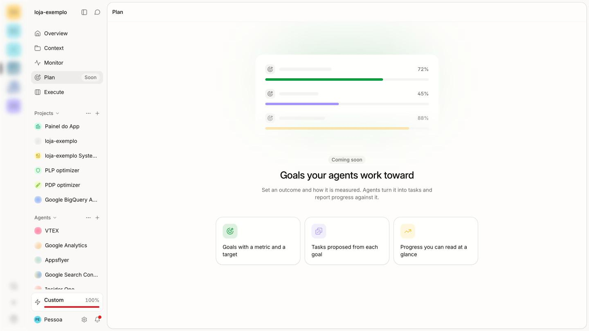

Enquanto isso, o diagnóstico estratégico de uma loja é feito à mão: entrevistas,
dados, pesquisas, benchmarks, oportunidades e soluções. No último caso em que
isso foi feito artesanalmente, levou cerca de dois meses. O Plan automatiza esse
trabalho de dois jeitos:

1. **Reativo, quando a pessoa tem uma ideia.** Ela escreve, grava um áudio ou
   anexa um arquivo ("trocar a cor do botão da PDP", "mostrar o prazo de entrega
   antes do carrinho"). O Studio monta o material que ela precisa para convencer
   o time: quem já faz, impacto estimado, esforço de desenvolvimento, tags,
   duração do teste A/B e ganho provável. É um *business case*, não uma
   resposta de chat.
2. **Proativo, quando ninguém pediu.** O Studio entende o objetivo da empresa
   (conversão, sessões, gastar menos, ticket), diagnostica as etapas da jornada
   que movem esse objetivo e entrega **as duas melhores oportunidades**, cada uma
   com evidência, hipóteses do porquê e um botão para virar business case.

## 2. Princípios

Vêm da reunião de produto sobre o futuro da PDP e da PLP:

| Princípio | Na prática |
| --- | --- |
| **Goal-driven** | A análise começa pelo objetivo do negócio, não por uma página ou ferramenta. Se o objetivo é conversão, aquisição de tráfego fica de fora. |
| **Hierárquico** | Dois níveis. Macro: *onde* atuar (mídia, PLP, PDP, checkout…). Micro: *o que* fazer dentro da área escolhida (o diagnóstico de PDP atual já é desse nível). |
| **Data-driven** | Todo número cita a fonte que respondeu nesta rodada. Número de fonte que não respondeu é descartado; oportunidade sem número válido vira "limite", não some. |
| **Poucas e defensáveis** | Explorar muitas hipóteses por dentro, mostrar só as que sobrevivem. Antes de mostrar, conferir que o problema ainda existe na loja ao vivo: um problema que já foi corrigido derruba a confiança no plano inteiro. |
| **Solution-oriented** | O resultado liga Problema → Hipótese → Solução → Impacto. Quando já existe uma solução da deco para o problema (por exemplo, compre-o-look automático, régua de vestibilidade, fundo de imagem), ela é recomendada. |
| **Restrições reais** | Áreas podem estar bloqueadas (outro time, outro decisor, um checkout recém-redesenhado). A pessoa pode marcar uma área como "fora de escopo agora", e a análise respeita isso. |

## 3. Experiência

### 3.1 Desenho de referência

Os dois mockups abaixo são a direção visual.

| Claro | Escuro |
| --- | --- |
| 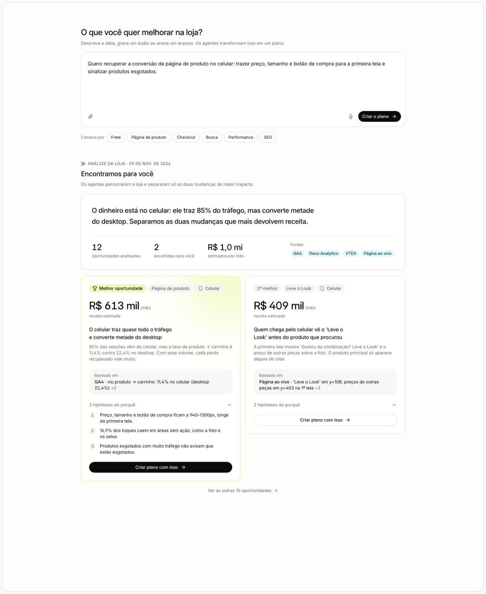 | 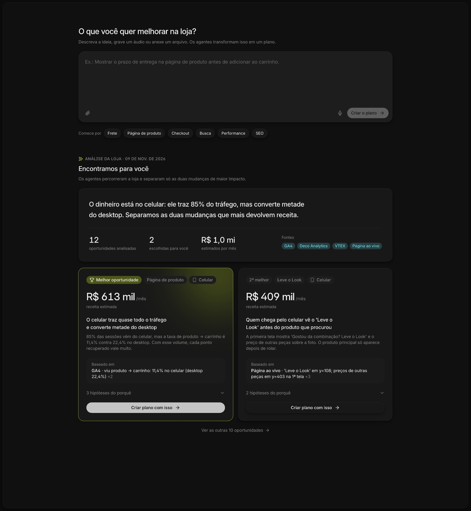 |

### 3.2 Protótipo com o tema do Studio

O protótipo usa os tokens reais do Studio (`packages/ui/src/styles/global.css`:
`surface`, `surface-inset`, `hairline`, `text-meta`, `brand`, `brand-lime-tint`,
modo escuro automático pelos tokens). Ele inclui uma peça que os mockups não
têm: o **objetivo inferido**, visível e trocável.

| Claro | Escuro |
| --- | --- |
| 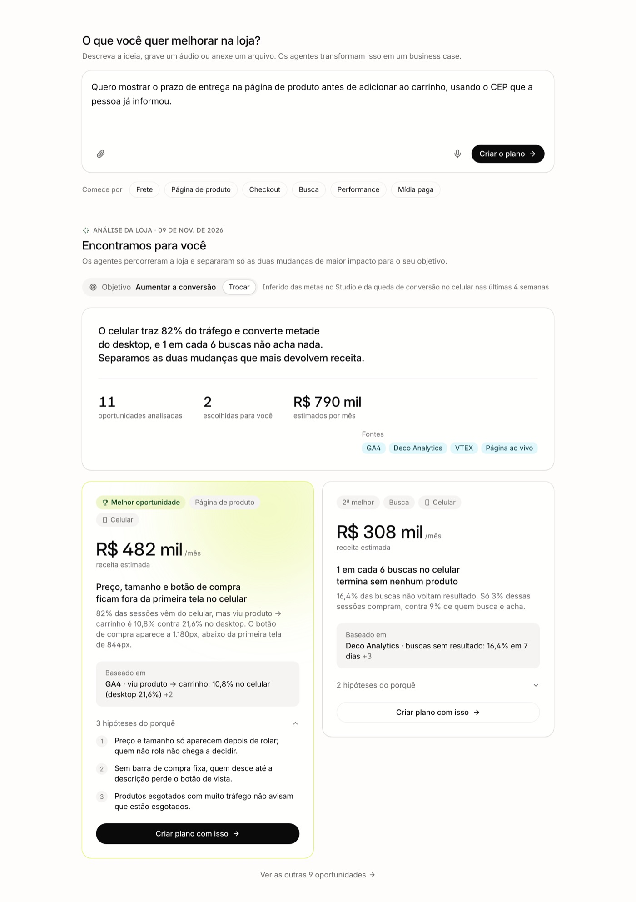 | 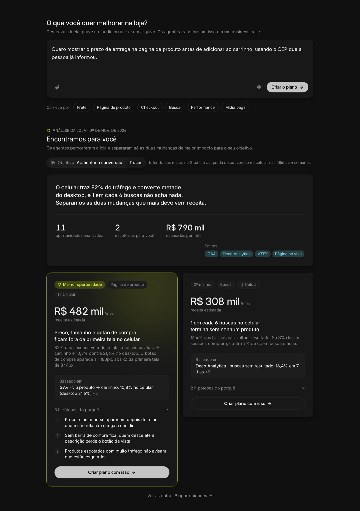 |

A página tem, de cima para baixo:

1. **Composer da ideia.** "O que você quer melhorar na loja?", com anexo, áudio
   e o botão "Criar o plano". Os chips "Comece por" (Frete, Página de produto,
   Checkout, Busca, Performance, Mídia paga) preenchem um ponto de partida.
2. **Cabeçalho da análise.** Data da última rodada e o **objetivo** com
   "Trocar". O objetivo é inferido e mostra de onde veio.
3. **Resumo.** Uma frase-manchete, o número de oportunidades analisadas, as
   escolhidas, R$/mês estimado e as fontes que responderam.
4. **Dois cards**, os únicos que aparecem de cara:
   - selo ("Melhor oportunidade" / "2ª melhor"), área e dispositivo;
   - receita estimada por mês;
   - título (o problema como conclusão) e resumo;
   - "Baseado em": o número mais forte com a fonte, e "+N" para os demais;
   - "N hipóteses do porquê", que expande;
   - "Criar plano com isso".
5. **"Ver as outras N oportunidades"** para a lista completa.

Neste exemplo, o objetivo "aumentar a conversão" levou a análise a duas áreas
diferentes: PDP e Busca. Isso é o nível macro funcionando, porque as duas
melhores não precisam ser da mesma página.

#### Trocar o objetivo

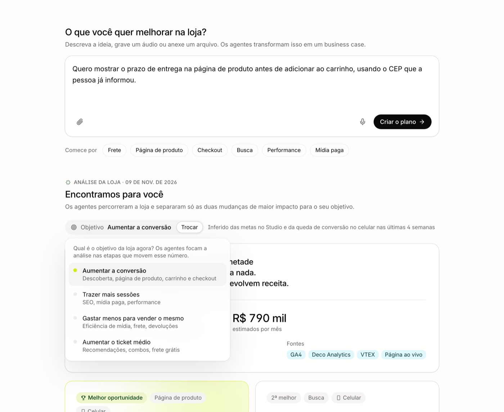

Cada objetivo declara as etapas que ele move. Trocar o objetivo dispara uma
nova rodada focada nessas etapas.

| Objetivo | Etapas investigadas |
| --- | --- |
| Aumentar a conversão | Descoberta (PLP, busca), página de produto, carrinho, checkout |
| Trazer mais sessões | SEO, mídia paga, performance |
| Gastar menos para vender o mesmo | Eficiência de mídia, frete, devoluções |
| Aumentar o ticket médio | Recomendações, combos, frete grátis |

#### Estados

| Rodando | Sem fontes conectadas |
| --- | --- |
| 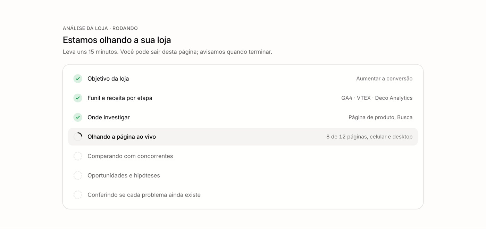 | 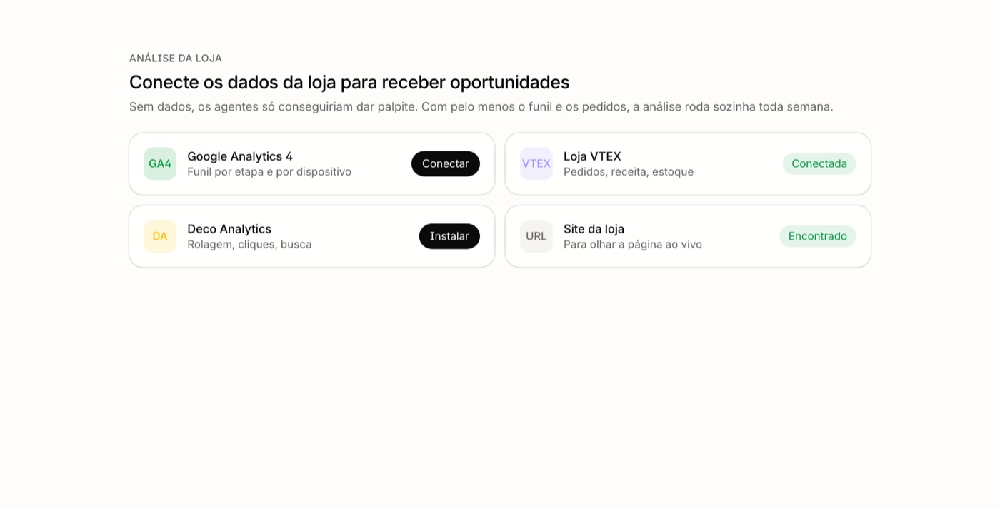 |

- **Rodando.** Mostra as etapas do pipeline com o progresso real do workflow.
  A pessoa pode sair da página; a conclusão chega por notificação.
- **Sem fontes.** Sem funil e pedidos não há análise, só palpite. A tela
  convida a conectar GA4, a loja e o Deco Analytics, usando os fluxos de
  conexão que já existem.
- **Erro.** Mostra a etapa que falhou e um botão para rodar de novo. Nenhuma
  etapa paga é repetida automaticamente (ver 5.1).

#### Largura estreita

Com o painel de chat aberto ao lado, a página encolhe. Os cards empilham e os
chips quebram linha.

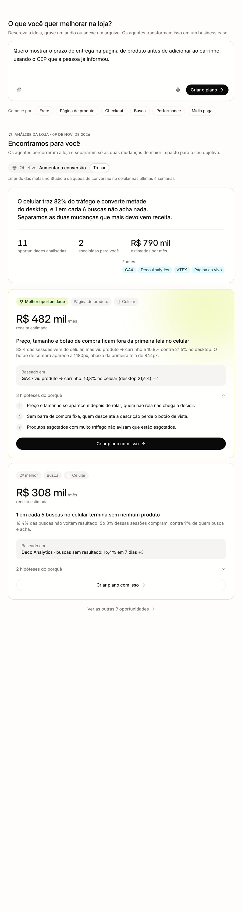

### 3.3 Business case

"Criar o plano" (ideia livre) e "Criar plano com isso" (oportunidade) abrem um
chat com o agente de Plan. O agente pesquisa, faz as contas e grava um
documento nos arquivos da org, em `planos/AAAA-MM-DD-<slug>.md`.

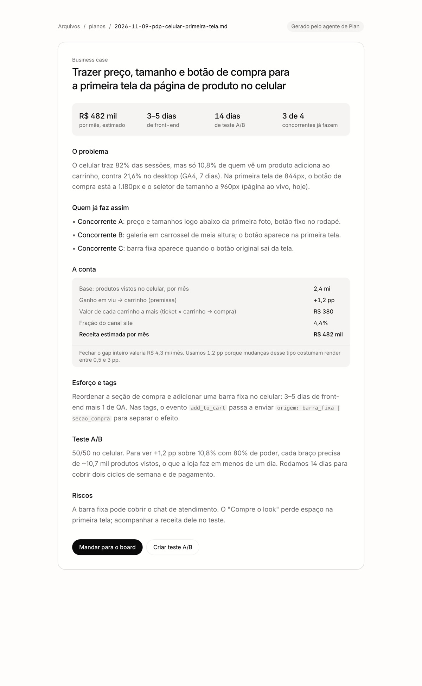

Seções do documento:

| Seção | Como é preenchida |
| --- | --- |
| Resumo em números | R$/mês, esforço, dias de teste, concorrentes que já fazem |
| O problema | As evidências da oportunidade, ou dados buscados para a ideia livre, sempre com a fonte e a janela |
| Quem já faz assim | Benchmark capturado na rodada (prints e descrição por concorrente) |
| A conta | `base × Δpp × valor por evento × fração do canal`, calculada pelo código (ver 6.4). O gap inteiro aparece só como teto. |
| Esforço e tags | Estimativa por tipo de mudança, mais as mudanças de evento necessárias para medir |
| Teste A/B | Tamanho de amostra a partir da taxa base, do MDE (o próprio Δpp) e do tráfego diário; duração mínima de 14 dias para cobrir ciclos de semana |
| Riscos | O que pode piorar e o que acompanhar durante o teste |
| Próximo passo | "Mandar para o board" (card no task board) e "Criar teste A/B" (`EXPERIMENT_CREATE`) |

Quando a origem é uma oportunidade, o chat recebe a oportunidade inteira:
título, fontes, conta e hipóteses. O agente não recomeça do zero. Na web isso
é `useChatTask().createTaskWithMessage(...)`
(`apps/web/src/components/chat/chat-context.tsx`), que já cria o chat ao lado
da página com a mensagem enviada.

## 4. Fluxo proativo

```text
objetivo  →  macro  →  investigação  →  validação  →  ranking  →  top 2  →  soluções
```

1. **Objetivo.** Lido do que a org já declarou (metas, contexto do projeto,
   conversas) e dos dados: por exemplo, queda de conversão em 4 semanas ou
   custo de mídia subindo. Guarda o objetivo, a evidência e se foi
   **inferido**, **confirmado** ou **trocado** pela pessoa. Uma escolha da pessoa
   nunca é sobrescrita pela inferência.
2. **Macro.** Para cada etapa ligada ao objetivo, mede a perda em pessoas e em
   dinheiro com dados agregados (funil GA4 por etapa e dispositivo, receita da
   VTEX, busca e rolagem do Deco Analytics). Sai uma lista ordenada de *onde
   investigar*. Etapas marcadas como fora de escopo são puladas.
3. **Investigação.** Nas 1 ou 2 etapas de maior perda roda o diagnóstico
   profundo daquela área: hoje, o de PDP portado (seção 5); depois PLP, busca e
   mídia. Cada um devolve oportunidades e hipóteses no mesmo formato.
4. **Validação.**
   - Descarta números de fontes que não responderam.
   - Descarta concorrentes não capturados.
   - Recaptura a página ao vivo das 2 finalistas para confirmar que o problema
     ainda está lá.
   - Uma finalista que caiu na validação vira "limite" e a próxima sobe.
5. **Ranking.** `monthly_value × confidence`, o mesmo critério do diagnóstico
   atual. O objetivo já filtrou as etapas, então não entra como peso extra.
6. **Top 2.** Grava as duas como "escolhidas" e o resto fica em "outras N".
7. **Soluções.** Cada hipótese é comparada com um catálogo de soluções
   existentes (apps e agentes da deco). Quando bate, o card mostra a solução, e
   o business case passa a incluir "usar a solução X" com esforço menor.

**Quando roda:**
- uma vez por semana, para cada org com o recurso ligado e com fontes conectadas;
- quando a pessoa troca o objetivo;
- quando a pessoa pede ("Rodar de novo").

Uma rodada por org de cada vez: um novo pedido com uma rodada em andamento
devolve a que está rodando.

## 5. O diagnóstico de PDP existente, que será portado

O diagnóstico de PDP já existe como app externo (Cloudflare Worker + MCP App).
Os números do mockup vêm de uma rodada real dele. As telas abaixo foram
capturadas com dados mascarados.

| Lista de diagnósticos e fontes | Um diagnóstico |
| --- | --- |
| 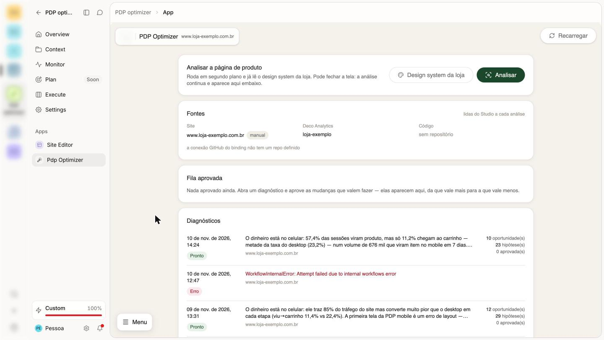 | 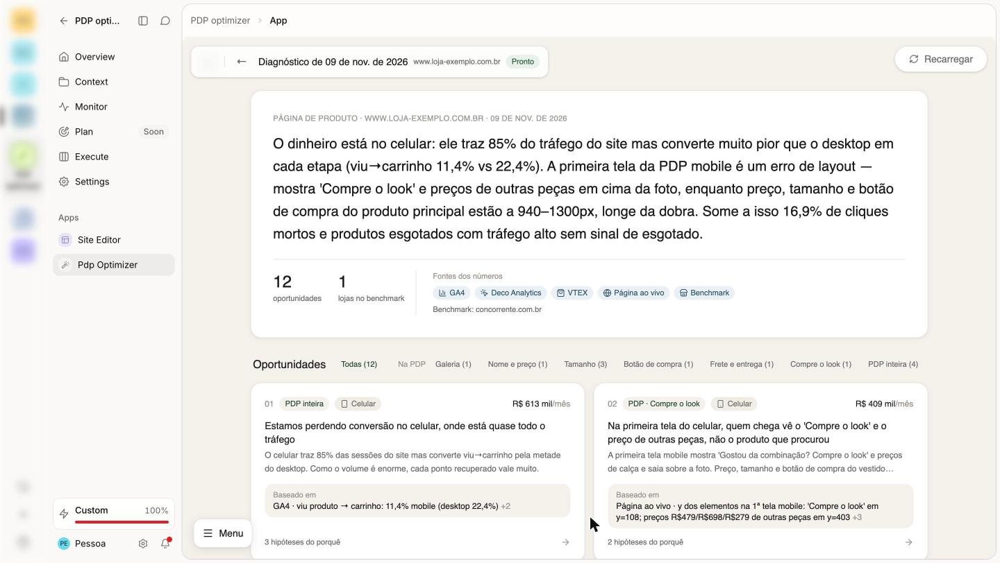 |

| Oportunidade e fontes | Hipótese: porquê, sinais, o que fazer, quem já faz |
| --- | --- |
| 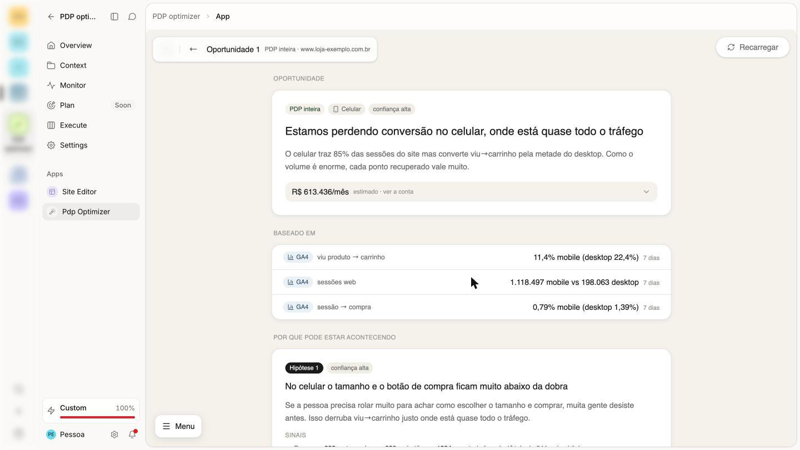 | 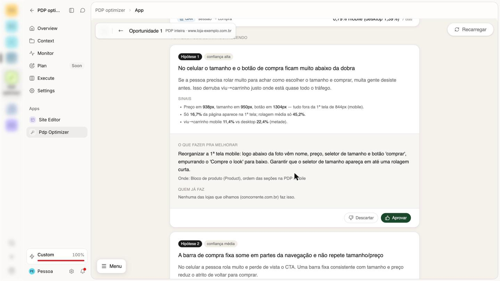 |

### 5.1 Pipeline atual

Cada etapa abaixo é um step do Cloudflare Workflow. Uma rodada custa por volta
de US$ 0,70–0,90 e leva de 10 a 15 minutos.

| Etapa | O que faz |
| --- | --- |
| `collect` | Funil GA4 por plataforma e dispositivo (BigQuery, 7 dias); heatmap e seções do Deco Analytics; receita por canal (lake); estoque VTEX dos 40 produtos mais vistos; tokens de tema do repositório (opcional) |
| `capture` | Abre PDPs reais no celular e no desktop; tira prints da primeira tela e da página inteira; mede o `y` de preço, tamanho, botão, frete e recomendação; detecta barra fixa e sinal de esgotado; lê o design system |
| `benchmark` | O modelo sugere até 8 concorrentes; captura até 5 (alguns bloqueiam bots); uma passada de visão descreve cada área. Cache de 30 dias. |
| `opportunities` | Uma chamada com todos os dados e prints gera até 20 oportunidades, cada uma com área, dispositivo, fontes citadas e os termos da conta |
| `hypotheses:<n>` | Lotes de 4 oportunidades por chamada, com 2–3 hipóteses cada: porquê, sinais, o que fazer, onde e quem já faz |
| `finish` | Manchete, limites e custo total |

Regras que vêm junto com o port:
- Toda fonte que falha vira uma **lacuna nomeada** e a rodada continua.
- O modelo **propõe** os termos da conta e o código **calcula**. `Δpp` fica
  entre 0 e 5 (o prompt pede 0,3–3), e a fração do canal fica em (0, 1]. Uma
  conta inválida zera o R$, mas mantém a oportunidade.
- Steps pagos **não têm retry automático**: falhou, a pessoa vê e roda de novo.

### 5.2 De → para

| No app externo | No Studio | Observação |
| --- | --- | --- |
| Cloudflare Workflow (com *handoff* por limite de subrequests) | Workflow DBOS em `apps/api`, um step por etapa e por lote. Modelo: `apps/api/src/monitoring/dbos-order-monitor.ts` | O handoff some: não há limite de subrequests por instância |
| D1 | Tabelas Postgres com migration Kysely aditiva em `apps/api/migrations/` | Ver seção 6 |
| R2 (prints) | Object storage da org | Prints entram no limite de tamanho e são apagados com o diagnóstico |
| `@cloudflare/puppeteer` | Chromium headless da imagem do sandbox (`packages/sandbox`, a mesma usada por `qa-screenshot`), chamado por um step do workflow | **Decisão aberta**: alternativa é um serviço de captura dedicado. Ver seção 9. |
| GA4 via BigQuery | `metrics` do customer lake (`CUSTOMER_LAKE_QUERY`, `apps/api/src/tools/customer-lake/index.ts`) | **Lacuna:** o funil do lake separa só por plataforma (web, iOS, Android). Celular × desktop dentro do site, que é a comparação central do diagnóstico, precisa de uma dimensão `deviceCategory` na ingestão do GA4. |
| Heatmap via REST | A mesma visão que o Studio já serve em `GET /api/:org/hosting/:site/analytics/data?view=heatmap` (`apps/api/src/api/routes/hosting.ts`), chamada por dentro | Busca sem resultado, rolagem, cliques mortos e seções |
| Receita VTEX | `customer_lake.orders` e `sales_channels` | Já usado pelo Monitor |
| Estoque VTEX ao vivo | Conexão VTEX da org | Só os produtos mais vistos |
| OpenRouter | `aiProviders` + `retryGenerateObject` com schema Zod (padrão de `apps/api/src/tools/experiments/suggest.ts`) | Usa o orçamento de IA da org; o custo por rodada é gravado |
| Cache de benchmark (30 dias) | Tabela com TTL de 30 dias e limite de tamanho por domínio | Chave por domínio do concorrente; nunca guarda dado da org |
| Tela própria (MCP App) | Página Plan e uma página de detalhe da oportunidade, no web do Studio | |

**Sai do port:**
- o "Antes/Depois" da v1, que a v2 já tinha removido por custo;
- o "ver no código", que vira o "Mandar para o board": um card no task board
  que o agente de código executa.

**Fica para depois:** módulos do app que não são diagnóstico (lotes de escrita
na VTEX, compre-o-look, Instagram, vestibilidade). Eles entram no catálogo de
soluções como soluções existentes, e não são portados.

## 6. Modelo de dados e API

### 6.1 Tabelas (uma migration aditiva)

| Tabela | Campos principais |
| --- | --- |
| `plan_objectives` | `organization_id` (único), `objective` (`conversion` \| `sessions` \| `efficiency` \| `ticket`), `source` (`inferred` \| `confirmed` \| `chosen`), `evidence` (jsonb), `out_of_scope_stages` (text[]), `updated_by`, `updated_at` |
| `plan_diagnoses` | `id`, `organization_id`, `objective`, `trigger` (`schedule` \| `objective_changed` \| `manual`), `status`, `stage`, `progress_note`, `headline`, `limits` (jsonb), `gaps` (jsonb), `evidence` (jsonb), `cost_usd`, `started_at`, `finished_at`, `error` |
| `plan_opportunities` | `id`, `diagnosis_id`, `rank`, `stage` (macro), `area` (micro), `device`, `title`, `summary`, `sources` (jsonb), `money` (jsonb), `confidence`, `chosen` (bool), `validated_at` |
| `plan_hypotheses` | `id`, `opportunity_id`, `rank`, `title`, `why`, `evidence_md`, `idea`, `where`, `confidence`, `benchmark` (jsonb), `solution_key` (nullable) |
| `plan_benchmark_cache` | `domain`, `page_type`, `payload` (jsonb), `captured_at` (TTL de 30 dias) |

Ciclo de vida:
- Todas as tabelas são filtradas por `organization_id`, direto ou pelo
  diagnóstico.
- Apagar um diagnóstico apaga as oportunidades, as hipóteses e os prints dele.
- Manter os últimos 10 diagnósticos por org.
- Ao começar uma rodada nova, o "top 2" visível continua sendo o da última
  rodada concluída até a nova terminar.

### 6.2 Tools

Seguem `apps/api/AGENTS.md`:
- `defineTool` com Zod e `ctx.access.check()`;
- registro em `packages/shared/src/tools/registry-metadata.ts`;
- permissões novas `plan:read` e `plan:write`.

| Tool | Faz |
| --- | --- |
| `PLAN_OBJECTIVE_GET` / `PLAN_OBJECTIVE_SET` | Lê ou define o objetivo e as etapas fora de escopo |
| `PLAN_DIAGNOSIS_START` | Começa uma rodada, ou devolve a que já está rodando |
| `PLAN_DIAGNOSIS_GET` / `PLAN_DIAGNOSIS_LIST` | Estado, progresso, resumo e lacunas |
| `PLAN_OPPORTUNITY_LIST` / `PLAN_OPPORTUNITY_GET` | Top 2, as outras N, e o detalhe com hipóteses |
| `PLAN_BUSINESS_CASE_CREATE` | Recebe uma ideia ou um `opportunity_id`; o agente de Plan usa esta tool para gravar o documento e devolver o caminho |

### 6.3 Tempo real e notificação

- O workflow emite `plan.diagnosis.updated` (constante em `packages/shared`)
  com `sseHub.emit(orgId, …)` a cada mudança de etapa e no fim.
- O web adiciona o tipo a `WATCH_TYPES` (`apps/web/src/hooks/watch-sse-pool.ts`)
  e assina com `useSyncExternalStore`.
- O poll lento continua como fallback.
- No fim da rodada, `notify()` avisa quem iniciou ou, na rodada semanal, os
  admins. O novo tipo de notificação precisa de migration, por causa do
  CHECK da tabela.

### 6.4 A conta

Fica igual à do app atual (`money.ts`), portada com os mesmos testes:

```text
receita/mês = base × (Δpp / 100) × valor por evento × fração do canal
```

`base`, `valor` e `premissa` precisam ter nome. `Δpp` fica em (0, 5]. O teto
(o gap inteiro) só aparece como referência e nunca como promessa.

## 7. Web

- `apps/web/src/routes/workspace/plan.tsx` passa a renderizar `PlanPage` dentro
  de `ChatLayout.Content`. O título vem de `staticData.pageTitle`, como nas
  outras páginas.
- Componentes do Studio: `Page`, `Page.Content`, `Page.Container`, `Badge`
  (variante `lime` para "Melhor oportunidade"), `Button` e as utilities de
  superfície. O composer reaproveita o `ChatInput` (anexo, áudio, Tiptap) ou o
  shell `packages/ui/src/components/composer.tsx`.
- Textos em `t()`, com chaves novas em `src/i18n/en/plan.ts` e
  `src/i18n/pt-br/plan.ts`.
- Remover `soon: true` do item Plan, `ComingSoonPage` e as chaves
  `home.comingSoon.*`, que ficam sem uso.
- Sem `useEffect`, `useMemo` nem `useCallback` (`apps/web/AGENTS.md`).
- Eventos: `plan_idea_submitted`, `plan_opportunity_opened`,
  `plan_business_case_created`, `plan_objective_changed`.

## 8. Fases

| Fase | Entrega | Gate |
| --- | --- | --- |
| **F1 — Página e business case reativo** | Página com composer e chips; agente/skill de Plan; documento gravado em arquivos; "Mandar para o board". Sem a seção proativa. | Nenhum: substitui o coming soon |
| **F2 — Objetivo** | `plan_objectives`, inferência, chip "Objetivo · Trocar", etapas fora de escopo | Flag de org `plan_proactive_enabled` (default off) |
| **F3 — Diagnóstico de PDP portado** | Workflow DBOS, captura, benchmark, oportunidades, hipóteses, validação e top 2 na página; rodada semanal | Mesma flag; a rodada semanal tem a sua própria, `plan_weekly_sweep_enabled` |
| **F4 — Macro e outras áreas** | Diagnóstico macro por etapa; PLP e busca; depois mídia paga | Por área |
| **F5 — Catálogo de soluções** | Hipótese → solução existente, com esforço menor no business case | — |

Pré-requisitos fora deste repositório:
- `deviceCategory` no funil GA4 do lake, para a F3;
- definir o executor de captura (seção 9), também para a F3.

## 9. Riscos e decisões abertas

- **Executor do navegador.** O sandbox já tem Chromium, mas foi feito para
  agentes, não para steps curtos de workflow. Alternativas: um pool de sandboxes
  de captura, ou um serviço de captura dedicado. Precisa de decisão antes da F3,
  medindo custo e latência para cerca de 12 páginas mais 5 concorrentes.
- **Celular × desktop no lake.** Sem a dimensão de dispositivo, a principal
  oportunidade do diagnóstico atual não pode ser calculada. Alternativa
  provisória: usar `site_traffic_hourly` (Deco Analytics, que já separa por
  dispositivo) para a parte do site.
- **Dado velho.** A validação na página ao vivo resolve o "problema que já foi
  corrigido". Os números de funil ainda têm uma janela de 7 dias, e a doc do
  business case mostra a janela de cada número.
- **Custo.** Cerca de US$ 0,8 por rodada, uma rodada por semana por org, mais
  as rodadas manuais. Respeita o orçamento de IA da org e mostra o custo da
  rodada.
- **Concorrentes que bloqueiam bots.** A rodada continua com quem respondeu e
  diz quantos foram capturados ("1 loja no benchmark").
- **Medir acerto.** Ligar o business case ao experimento criado
  (`EXPERIMENT_CREATE` → `EXPERIMENT_RESULTS`) e mostrar, depois, a estimativa
  ao lado do resultado.
- **Inferência de objetivo errada.** O objetivo fica visível e é trocado em um
  clique. A rodada guarda qual objetivo usou.

## 10. Sobre os prints

| Arquivo | Origem |
| --- | --- |
| `mockup-*.jpg` | Mockups de design |
| `proto-*.jpg` | Protótipo HTML estático com o tema do Studio e dados sintéticos. Não faz parte do produto. |
| `current-coming-soon.jpg` | Studio em produção; org, pessoa e outras orgs mascaradas |
| `pdp-optimizer-*.jpg` | App externo de diagnóstico em produção; domínio, marca, concorrentes e imagens mascarados |
